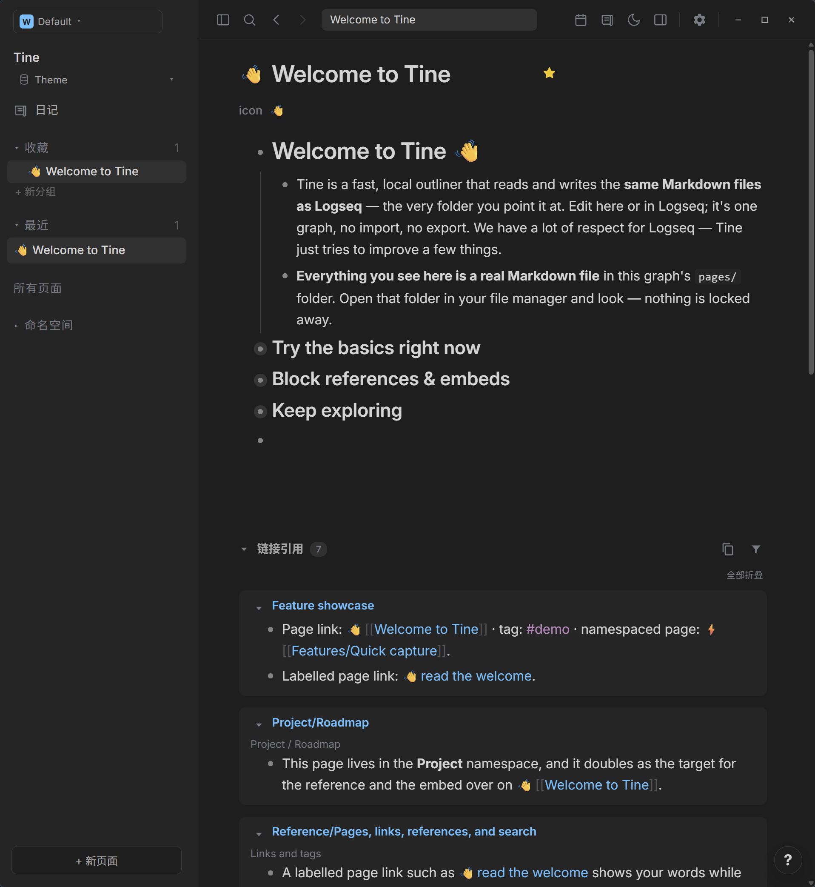
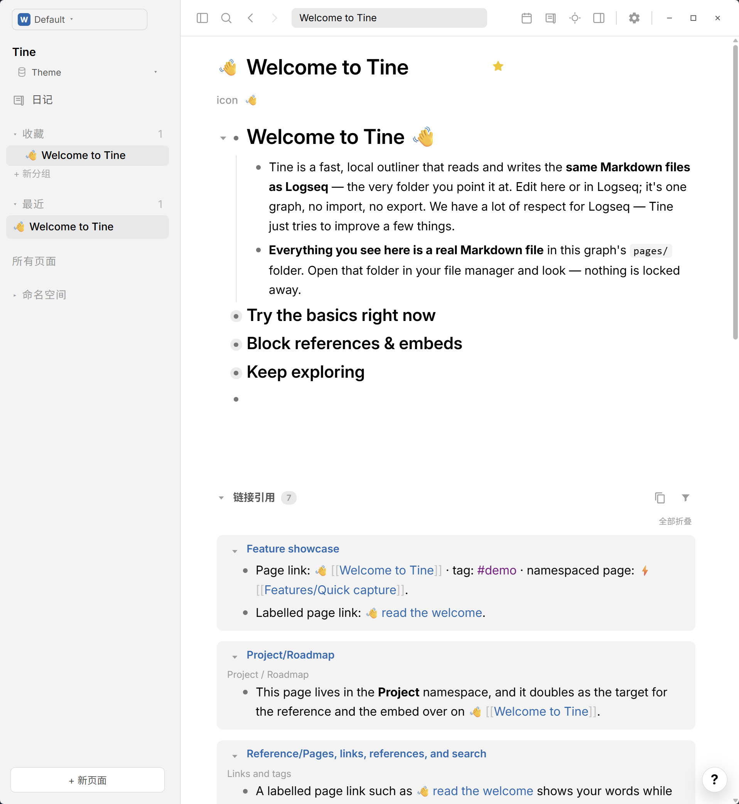

# VS Code Plus · Prism

**白页如晨光展开，炭灰收拢余晖；几笔蓝色，连起念头之间的路。**

[English](README.md) · [下载 theme.json](https://github.com/EllisMorrow/tine-theme-vscode-plus-prism/releases/latest/download/theme.json)

熟悉的 Light+ 与 Dark+ 色板，以明亮纸白和沉静炭灰相配，再由 VS Code 经典蓝色相连。

在 [Prism 主题画廊](https://github.com/martinkoutecky/tine/discussions/786)中，可以直观比较全部 29 个主题的浅色与深色效果。

### 深色模式

### 浅色模式

*用户测试后提供的 Windows 实机截图，两套配色均实际包含在同一个主题包中。*

## 安装

1. 下载 [theme.json](https://github.com/EllisMorrow/tine-theme-vscode-plus-prism/releases/latest/download/theme.json)。
2. 在 Tine 打开 **设置 → 外观 → 主题包 → 选择 theme.json**，选择下载的文件。
3. 点击 **使用颜色**，选择 **浅色、深色或跟随系统**。

需要主题 API **0.2** 支持。原有 `logseq/custom.css` 和设备强调色可能影响效果；主题只负责 API 支持的颜色，不包含额外字体、布局或任务标记样式。

## 配色

| 角色 | 浅色 | 深色 |
| --- | --- | --- |
| 主背景 | `#FFFFFF` | `#1E1E1E` |
| 侧栏 | `#F3F3F3` | `#252526` |
| 正文 | `#000000` | `#D4D4D4` |
| 标题 | `#000000` | `#D4D4D4` |
| 强调色 | `#007ACC` | `#007ACC` |
| 链接 | `#006AB1` | `#4FC1FF` |
| 标签 | `#800080` | `#C586C0` |
| 高亮底色 | `#FFF2CC` | `#51472f` |

## 验证情况

通过官方主题格式检查；浏览器样例检查了两套完整变量、模式切换及指定颜色组合。用户提供了上方 Windows 明暗实机截图，展示公开欢迎页面上的标题、正文、层级、链接、标签、行内代码和引用区域。高亮、选中操作、设置状态和其它平台未由这些截图覆盖，不据此宣称全部路径均已验证。

## 来源与边界

基于 [Visual Studio Code Light+ / Dark+](https://github.com/microsoft/vscode)，固定版本 `4bda7217fc83e8e838b1edd9ebaf21bb9b498c7e`，采用 MIT 许可；详见 [许可说明](LICENSE)。基于 Microsoft VS Code 官方仓库中固定版本 4bda7217fc83e8e838b1edd9ebaf21bb9b498c7e 的 Light+ 与 Dark+ 内置主题，许可为 MIT；Tine 角色映射为独立适配。

独立社区适配由 EllisMorrow 完成，使用 AI 辅助开发。不分发 Codex 程序代码、标志或附带资源，不代表相关项目或 OpenAI 的官方产品，也不承诺与 Codex 像素级一致。具体映射和验证边界见 [适配说明](docs/adaptation.md)。

顶部徽标统计 GitHub Release 附件累计下载量，不代表安装人数。可在本仓库反馈问题，附版本、系统、模式及不包含私人内容的截图。
